# 1. Quick Start Guide

HCCL (Huawei Collective Communication Library) is a high-performance communication library designed for Ascend AI processors. It shares similarities with Nvidia’s NCCL library, primarily focusing on collective communication operations. The CANN library includes a suite of test tools to analyze collective communication performance.

## 1.1 Setting Up the Compilation Environment

For initial environment setup, refer to the [Docker Creation Guide for Ascend](https://gitee.com/zzudongxiang/ascend.docker). All subsequent processes require a platform with HCCL hardware support. Note that Ubuntu version 20.04LTS or higher is recommended to avoid compatibility issues with VSCode.

### 1.1.1 CANN Installation

Follow the **CANN Installation** section of the [Docker Creation Guide for Ascend](https://gitee.com/zzudongxiang/ascend.docker) documentation. Record the installation location for future reference.

After completing CANN installation, it’s recommended to add the following environment variable to your `~/.bashrc` file:

```bash
# Open ~/.bashrc using nano
nano ~/.bashrc
```

Add the following line at the end of the file:

```bash
export ASCEND_HOME=/usr/local/Ascend/ascend-toolkit/latest
```

### 1.1.2 OpenMPI Installation

Download the appropriate version from the [OpenMPI official website](https://www.mpich.org/). For example, use version `mpich-4.2.0`:

```bash
# Download mpich (see link: https://www.mpich.org/static/downloads)
wget https://www.mpich.org/static/downloads/4.2.0/mpich-4.2.0.tar.gz
# Decompress the package
tar -zxvf mpich-4.2.0.tar.gz
```

Configure the MPI installation path, for example, `/root/mpich`:

```bash
# Create a new directory
mkdir ~/mpich
# Navigate to the decompressed directory
cd mpich-4.2.0
# Configure installation path
./configure --prefix=/root/mpich --disable-fortran
```

Build the MPI executable files using `make`. This process may take a significant amount of time:

```bash
make
make install
```

After installation, update the environment variables to include the link libraries and help files:

```bash
# Edit ~/.bashrc
nano ~/.bashrc
```

Add the following lines at the end:

- `export MPI_HOME=/root/mpich`
- `export PATH=$MPI_HOME/bin:$PATH`
- `export MANPATH=$MPI_HOME/man:$MANPATH`
- `export LD_LIBRARY_PATH=$MPI_HOME/lib:$LD_LIBRARY_PATH`

## 1.2 Compiling the Files

This section references the guide: [Ascend Snt9B Collective Communication Operator Single-Machine Multi-Card Performance Test Guidance](https://bbs.huaweicloud.com/blogs/413870).

To facilitate future modifications to files within `hccl_test` and maintain a copy of the unmodified source files, it’s recommended to copy the corresponding files to a user directory, such as `/root/Workdir`:

```bash
cp -r /usr/local/Ascend/ascend-toolkit/7.0.0/tools/hccl_test /root/Workdir/
```

Since the folder pointed to by `ASCEND_HOME` is a symbolic link, when copying the `hccl_test` folder, ensure you copy the source files rather than the folder link. You can check the real file path using the following command:

```bash
# Navigate to ASCEND_HOME path
cd $ASCEND_HOME/tools
# Check the real address of the link
ll
```

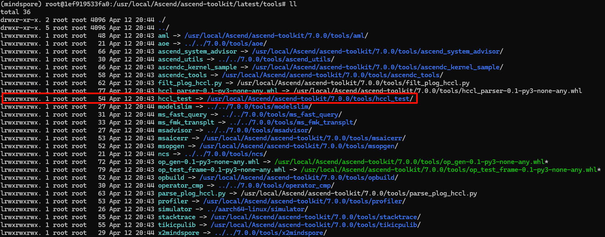

Switch to the copied folder and execute the compilation command:

```bash
# Navigate to the copied folder
cd /root/Workdir/hccl_test
# Compile the files
make MPI_HOME=/home/mpich ASCEND_DIR=/usr/local/Ascend/ascend-toolkit/latest
```

After compilation, multiple *_test executable files will appear in the newly created `./bin` directory.

## 1.3 Running the Test Cases

Run the following command to perform a basic test:

```bash
# mpirun -n 8 * starts 8 processes using MPI; ensure consistency with the final -p parameter
mpirun -n 8 ./bin/all_reduce_test -b 8 -e 2048M -f 2 -p 8
```

The test configuration parameters and their explanations are as follows:

```test
-b,--minbytes <min size in bytes>
-e,--maxbytes <max size in bytes>
-i,--stepbytes <increment size>
-f,--stepfactor <increment factor>
-n,--iters <iteration count>
-o,--op <sum/prod/min/max>
-d,--datatype <int8/int16/int32/fp16/fp32/int64/uint64/uint8/uint16/uint32/fp64/bfp16>
-r,--root <root>
-w,--warmup_iters <warmup iteration count>
-c,--check <result verification> 0:disabled 1:enabled.
-p,--npus <npus used for one node>
-h,--help
```

To adjust the HCCL communication buffer size (the amount of data that can be sent/received per HCCL communication), set the environment variable `HCCL_BUFFSIZE` before execution, in MB. For example, set the buffer size to 2GB:

```bash
export HCCL_BUFFSIZE=2048
```

# 2. Configuring the Debugging Environment

To facilitate debugging and analyzing the real-time effects of various parameters in the hccl_test tool, configure a debugging environment for step-by-step debugging. By capturing register values during runtime, you can observe the actual functions corresponding to each parameter.

## 2.1 VSCode Configuration

Install the `Remote-SSH` plugin in VSCode to connect to a remote server. For plugin installation details, refer to other tutorials. After connecting to the remote server using `Remote-SSH`, install the `C/C++`, `Jupyter`, and `Python` extensions.

Log in to the server using `Remote-SSH` in the specified folder and create a `.vscode` directory. Within this directory, create the following three configuration files: `c_cpp_properties.json`, `launch.json`, and `tasks.json`.

### 2.1.1 c_cpp_properties.json

The [c_cpp_properties.json file](./.vscode/c_cpp_properties.json) is used to configure static check results display in the editor. For example, if some header files cannot be found, red waves will appear.

- **includePath**: Add the paths of the required header files to this field.

### 2.1.2 launch.json

The [launch.json file](./.vscode/launch.json) is used to configure the debugger. When debugging C/C++ tools, install the gdb tool first using the command: `apt install gdb`

- **program**: The executable file generated after compilation. Compilation parameters can be found in the `tasks.json` file.
- **envFile**: Environment variables added during program execution. Refer to the `.env` file for details.
- **preLaunchTask**: Parameters for compiling executable files. Refer to the `tasks.json` file.

### 2.1.3 tasks.json

The [tasks.json file](./.vscode/tasks.json) is used to compile and generate executable files. Relevant compilation parameters must be added to this file. Parameter information can be found in the `Makefile` file.

- **label**: Corresponds to the `preLaunchTask` field in the `launch.json` file.

- **args**: Compilation parameters. Refer to the `Makefile` file for specifics.

## 2.2 MPI Parallel Debugging

### 1. Running the Startup Command

In the VSCode Debug menu, select `hccl_debug` for the file to be debugged and compile it, or switch to the `./hccl/` folder and use the `make` command to compile all executable files. Then, in a new terminal, switch to the current file directory and execute the following command, using `hccl_p2p_rootinfo_test` as an example, to create two processes:

```bash
# Set environment variable to wait for debugging process attachment
export HCCL_MPI_DEBUG=1
# Start 2 processes and attach debugging to both
mpirun -n 2 ./bin/hccl_p2p_rootinfo_test
```

At this point, the Terminal interface will be stuck, waiting for the debugging process to attach.

### 2. Debugging the Code

Set a breakpoint at the first line of `main.cc` and select `hccl_mpi_debug` to start the process attachment. After successful attachment, modify the value of `hccl_mpi_debug` to `false` and you can exit the while loop to perform code debugging.

Note that when attaching, the process to be selected is the running process, not the MPI process. In this example, search for and select the `hccl_p2p_rootinfo_test` process for attachment.

## 2.3 msprof Configuration

This section references the guide: [Collecting Ascend AI Processor System Data](https://www.hiascend.com/document/detail/zh/CANNCommunityEdition/80RC1alpha003/devaids/auxiliarydevtool/atlasprofiling_16_0012.html). You can directly run the corresponding execution parameters based on the documentation. However, for ease of program execution and debugging, refer to the [8-Card Trace Collection Script](./script/run_8npu.ipynb).

After running the script, timeline files will appear in the `./log/prof/*.json` directory. Open the [Perfetto](https://ui.perfetto.dev/) website and import the corresponding JSON file to view and analyze the test Trace.

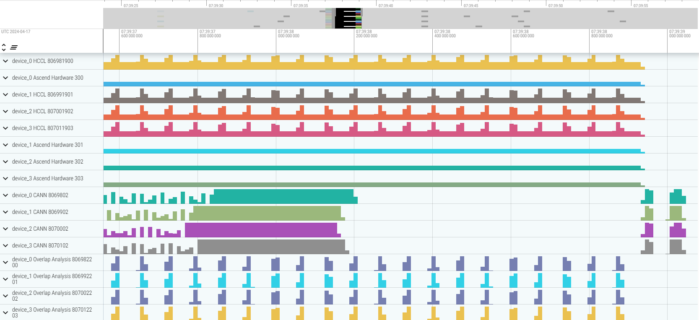

The point-to-point NPU test (data exchange) runs faster than the msprof trace capture, allowing you to test performance under different data packet sizes. Refer to the [Point-to-Point Test Script](./script/run_2npu.ipynb) for testing.

| Average Time | Algorithm Bandwidth |
|--------------|---------------------|
| 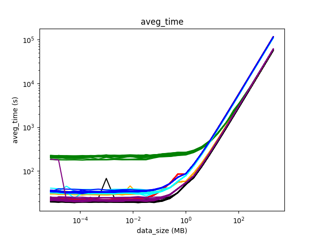 | 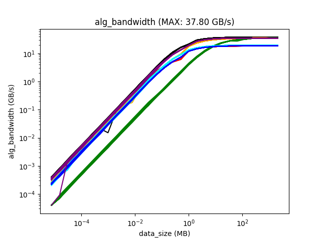 |

# 3. Point-to-Point Communication

The point-to-point communication code is referenced from [hccl_p2p_rootinfo_test.cc](./hccl/hccl_p2p_rootinfo_test.cc), which uses HCCL API for data sending and receiving. The code structure is the same as the original hccl_test. During point-to-point communication, ranks with `rank_id % 2 == 0` act as senders, while others act as receivers. Therefore, when performing point-to-point communication, ensure that the number of participating NPU cards is even; otherwise, communication may be blocked.

### 3.1 Point-to-Point Communication Bandwidth

Using NPU0 and NPU1 as examples, the memory size allocated each time ranges from 1kB to 2GB (actual communication volume is half of this value), doubling each time. The HCCL communication buffer is set to 2GB to ensure no buffer switching. The bandwidth data from multiple tests is shown in the figure below:

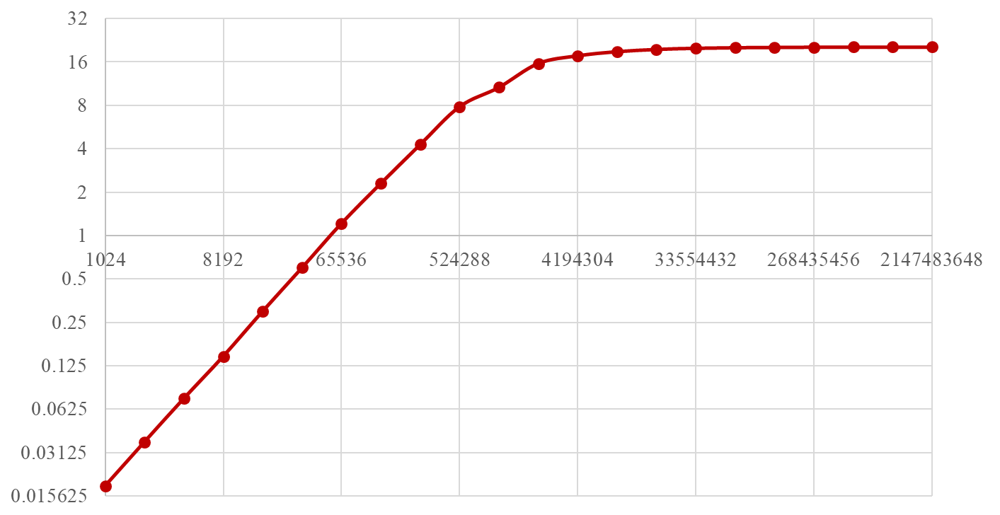

The communication bandwidth stabilizes at around 20GB/s, consistent with the Trace analysis results.

### 3.2 Trace Analysis

Using NPU0 and NPU1 as examples, the allocated memory size is 2GB, the actual communication size is 1GB, and the HCCL communication buffer is set to 2GB to ensure no buffer switching.

The source files for all traces can be found in: [p2p_trace.zip](./data/p2p_trace.zip)

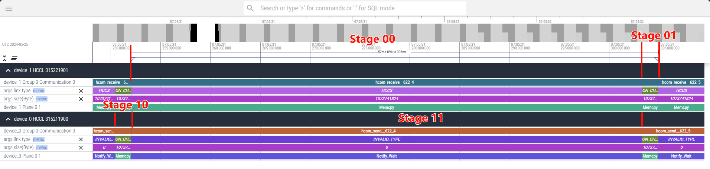

##### Stage 10 - Rank_0 copies 1GB of data to the HCCL buffer locally

##### Stage 00&Stage11 - Wait for transmission of 1GB of data

##### Stage 01 - Rank_1 copies 1GB of data from the local HCCL buffer to the receiving area

### 3.3 Issues

In the code, NPU0 acts as a sender sending data to NPU1, but in the Trace, it appears that NPU0 is waiting and NPU1 executed a memcpy operation. The memcpy’s src is `1` and dst is `0`. The result shows that the code’s operational logic is correct.

**Memory Check**

Rank_0 sets the send area data to `1`, and Rank_1 sets the send area data to `2`. After p2p communication (Rank_0 sending data to Rank_1), Rank_1’s receive area data becomes `1`, indicating that data from Rank_0 was received. The memory check result is normal.

# 4. Collective Communication Test Results

## 4.1 Trace Timeline Analysis

This section’s analysis is based on the **Broadcast** test case, with a data packet size of **2GB**, data type of **float** (4 bytes), HCCL communication buffer size of **2GB**, and **4** NPU cards as the test condition.

Trace source files can be found in: [broadcast_2.0GB.zip](./data/broadcast_2.0GB.zip)

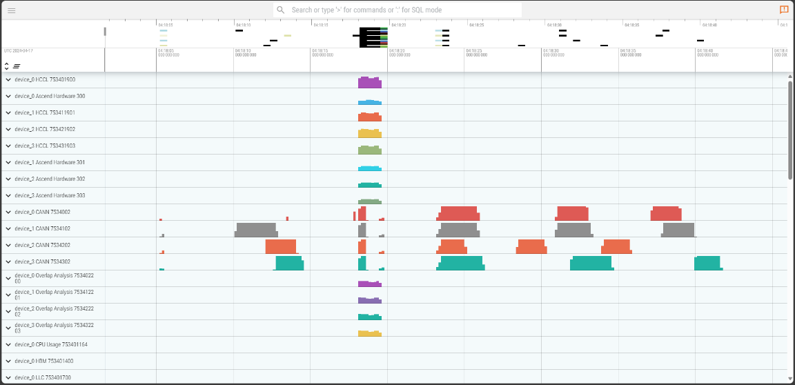

### Stage 1 - 1.692ms

Since the set data packet size is 2GB, 2GB of collective communication memory (Device side memory) must be allocated. Different algorithms have different memory requirements based on their characteristics.

**Note**: The data type is float, so the actual allocated space is 0.5GB of float data. All subsequent references are in bytes.

```bash
main()
 |- hccl_test->opbase_test_by_data_size()
     |- $ hccl_test->hccl_op_base_test()
         |- $ aclrtMalloc()
```

### Stage 2 - 8.097s

Allocate the same size (2GB) of Host side memory (64.476ms) and initialize it (8.033s)

```bash
main()
 |- hccl_test->opbase_test_by_data_size()
     |- hccl_test->hccl_op_base_test()
         |- $ aclrtMallocHost()
         |- $ hccl_host_buf_init()
```

### Stage 3 - 85.87ms

Copy the Host side memory to the Device side

```bash
main()
 |- hccl_test->opbase_test_by_data_size()
     |- hccl_test->hccl_op_base_test()
         |- $ aclrtMemcpy()
```

### Stage 4 - 4.286s

Allocate 2GB of verification memory space (65.484ms) on the Host side for memory data verification, and initialize the verification memory space (4.221s)

```bash
main()
 |- hccl_test->opbase_test_by_data_size()
     |- hccl_test->hccl_op_base_test()
         |- $ init_buf_val()
             |- $ aclrtMallocHost()
             |- $ hccl_host_buf_init()
```

### Stage 5 - 1750.615ms

Start collective communication. Detailed analysis is provided in the next section.

```bash
main()
 |- hccl_test->opbase_test_by_data_size()
     |- hccl_test->hccl_op_base_test()
         |- $ HcclBroadcast()
```

### Stage 6 - 170.652ms

Allocate 2GB of verification space on the Host side (64.736ms) and copy the communication results from the Device side to this space (105.916ms)

```bash
main()
 |- hccl_test->opbase_test_by_data_size()
     |- hccl_test->hccl_op_base_test()
         |- $ check_buf_result()
             |- $ aclrtMallocHost()
             |- $ aclrtMemcpy()
```

### Stage 7 - 3.535s

Verify the HCCL communication results, calculate and print the HCCL test results

```bash
main()
 |- hccl_test->opbase_test_by_data_size()
     |- hccl_test->hccl_op_base_test()
         |- check_buf_result()
             |- $ check_buf_result_float()
         |- $ cal_execution_time()
```

### Stage 8 - 115.893ms

Release the Device side’s 2GB sized Buffer

```bash
main()
 |- hccl_test->opbase_test_by_data_size()
     |- hccl_test->hccl_op_base_test()
         |- $ aclrtFree()
```

### Stage 9 - 19.554s

Release the verification Buffer, totaling three buffers, each 2GB in size

- **host_buf** is the Host side memory allocated in Stage 2 for initializing Device side memory data.
- **check_buf** is the Host side memory allocated in Stage 4, storing the original data for verification.
- **recv_buff_temp** is the Host side memory allocated in Stage 7, storing data from the Device side.

```bash
main()
 |- hccl_test->opbase_test_by_data_size()
     |- hccl_test->hccl_op_base_test()
         |- $ destory_check_buf()
             |- $ aclrtFreeHost()
```

### Timeline

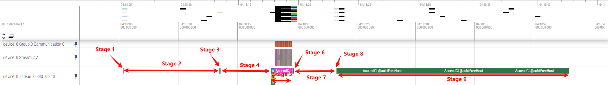

## 4.2 Different Collective Communication Buffers

The above tests are based on a buffer size that is large enough to send or receive all data packets in one go. When the HCCL buffer is insufficient, transmission of 2048MB of data is divided into slices.

Using the Broadcast algorithm as an example, set the HCCL Buffer size to 2048MB and 10MB respectively for testing. The HCCL communication trace results are shown in the figures below.

Source files can be found in: [broadcast_buffer2048M.zip](./data/hccl_buffer/broadcast_buffer2048M.zip) and [broadcast_buffer10M.zip](./data/hccl_buffer/broadcast_buffer10M.zip)

### 4.2.1 2048MB

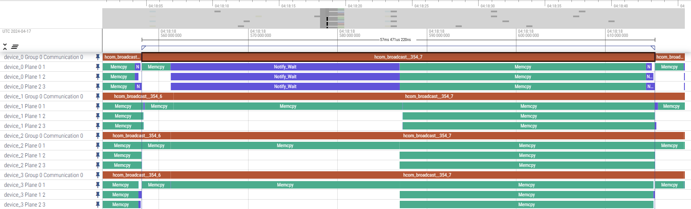

### 4.2.2 10MB

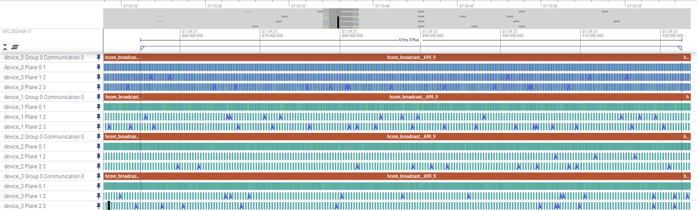

## 4.3 Different Collective Communication Algorithms

In the Trace, communication bandwidth data can be found in two places: checking the `HBM` data provides a global view of overall changes at a certain time interval, but with low granularity. The `HCCL` `memcpy` stage includes a `size` field that shows the specific `memcpy` memory amount at each stage.

In addition to the `size` field, the `HCCL` `memcpy` field includes other fields such as `link type`, `bandwidth`, `transport type`, `src rank`, and `dst rank`, which can be used for further analysis.

Using a data packet size of **2GB**, data type of **float** (4 bytes), HCCL communication buffer size of **2GB**, and **8** NPU cards as the test condition, the corresponding source files can be found in: [trace_log/](./data/trace_log/)

Note that all addresses obtained in this analysis are virtual addresses. Each rank may obtain the same virtual address (allocated by the memory management module), but the corresponding physical addresses are different. Therefore, address information cannot be used to determine whether the Buffer is reused.

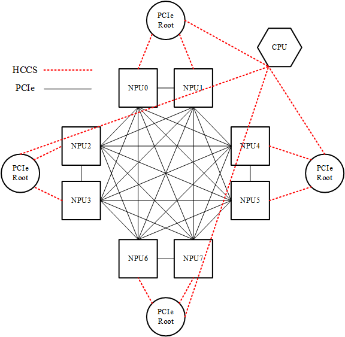

### 4.3.1 all_gather

#### A. Communication Primitive

AllGather is a multi-to-many communication primitive, with multiple data senders and multiple data receivers. It collects data from multiple nodes to one main node (Gather) and then distributes this collected data to other nodes (broadcast), effectively collecting all data from nodes to all nodes.

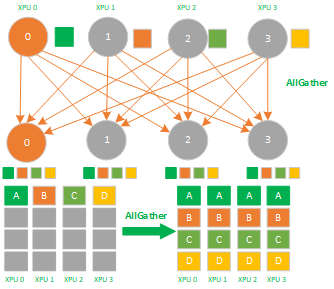

<center>All Gather Process</center>

AllGather is a multi-to-many synchronous full collection of data, which collects data from multiple XPU cards to multiple XPU cards. It can be seen as a combination of Gather + Broadcast operations. Its reverse operation corresponds to ReduceScatter. Application scenarios include:

- AllGather can be applied to model parallelism.
- In model parallelism, for forward calculation, parameters need to be fully synchronized. AllGather is used to synchronize parameters that are split across different XPUs to one XPU for forward calculation.

#### B. Host Side Memory

| Rank ID | Type | Host Pointer | Host Size | Value |
|---------|------|--------------|-----------|-------|
| 0-7 | init_buff | 0x124080c00000 | 256MB | 1, 2, 3, 4, 5, 6, 7, 8 |
| 0-7 | check_buff | 0x124a80000000 | 2GB | [1, 2, 3, 4, 5, 6, 7, 8]<br>[1, 2, 3, 4, 5, 6, 7, 8]<br>... |

#### C. Device Side Memory

| Rank ID | Type | Pointer | Malloc | Trans Count |
|---------|------|---------|--------|-------------|
| 0-7 | send | 0x124041200000 | 256MB | 64M (256MB) |
| 0-7 | recv | 0x1242c0000000 | 2GB | 64M (256MB) |

#### D. Trace Analysis

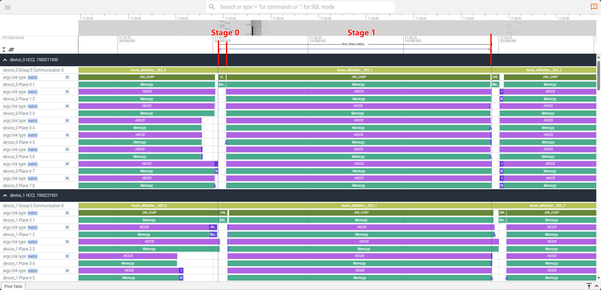

##### Stage 0 - Allocate 256MB of send buffer and memcpy the data to be sent

| src | dst | type | size |
|-----|-----|------|------|
| 0 | 0 | CHIP | 256MB |

##### Stage 1 - From other 7 NPU cards, obtain corresponding data to complete Gather

| src | dst | type | size |
|-----|-----|------|------|
| 0 | 0 | CHIP | 256MB |
| 0 | other (7) | HCCS | 256MB |
| other (7) | 0 | HCCS | 256MB |

### 4.3.2 all_reduce

#### A. Communication Primitive

AllReduce is a multi-to-many communication primitive, with multiple data senders and multiple data receivers. It performs the same Reduce operation on all nodes in the cluster and sends the result of the reduction to all nodes. AllReduce can be implemented through Reduce + Broadcast on the main node or ReduceScatter + AllGather. The process is as follows: first perform reduce on the main node to get the sum, then broadcast this sum to other nodes, ensuring every node in the cluster has the same value.

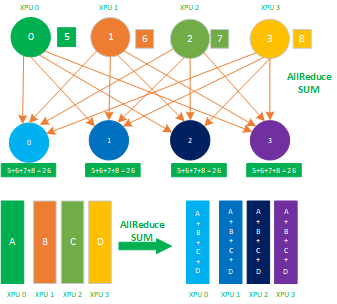

<center>All Reduce Process</center>

AllReduce is a multi-to-many synchronous reduction of data, which reduces data from all XPU cards to all XPU cards. Application scenarios include:

- AllReduce is applied to data parallelism.
- Various communication topologies in data parallelism, such as Ring allReduce, Tree allReduce, and allReduce operations.

#### B. Host Side Memory

| Rank ID | Type | Host Pointer | Host Size | Value |
|---------|------|--------------|-----------|-------|
| 0-7 | init_buff | 0x124440000000 | 2GB | 1, 2, 3, 4, 5, 6, 7, 8 |
| 0-7 | check_buff | 0x124bc0000000 | 2GB | 36 |

#### C. Device Side Memory

| Rank ID | Type | Pointer | Malloc | Trans Count |
|---------|------|---------|--------|-------------|
| 0-7 | send | 0x1242c0000000 | 2GB | 512M (2GB) |
| 0-7 | recv | 0x124380000000 | 2GB | 512M (2GB) |

#### D. Trace Analysis

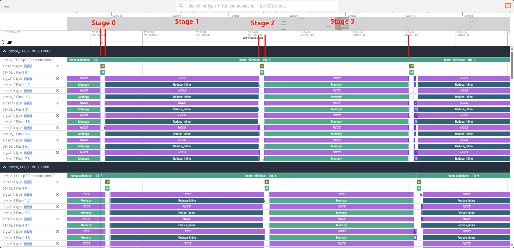

##### Stage 0 - Copy 256MB (1/8) of data to the send cache

| src | dst | type | size |
|-----|-----|------|------|
| 0 | 0 | CHIP | 256MB |

##### Stage 1 - Receive data from other 7 nodes and perform 1/8 of Reduce calculation

| src | dst | type | size |
|-----|-----|------|------|
| 0 | others (7) | HCCS (Reduce_FP32) | 256MB |

##### Stage 2 - Place the completed Reduce result into the send buffer

| src | dst | type | size |
|-----|-----|------|------|
| 0 | 0 | CHIP | 256MB |

##### Stage 3 - From other NPU, obtain another 7/8 of Reduce result

| src | dst | type | size |
|-----|-----|------|------|
| 0 | others(7) | HCCS | 256MB |
| others (7) | 0 | HCCS | 256MB |

### 4.3.3 alltoall

#### A. Communication Primitive

All-to-All operation means that each node’s data is scattered to all nodes in the cluster, and each node also gathers all nodes’ data. ALLTOALL is an extension of ALLGATHER. The difference is that in ALLGATHER, different nodes collect the same data to a certain node, while in ALLTOALL, different nodes collect different data to a certain node, as shown in the figure below:

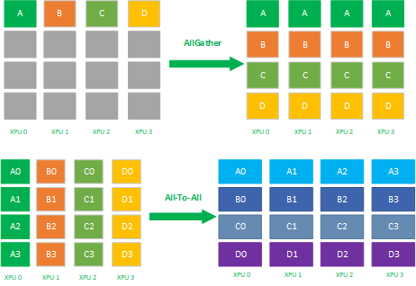

<center>All to All Process</center>

AllToAll is a multi-to-many data transposition, which transposes data from all XPU cards to all XPU cards. Main application scenarios include:

- AllToAll is applied to model parallelism.
- Matrix transposition in model parallelism.
- Data parallelism to model parallelism matrix transposition.

#### B. Host Side Memory

| Rank ID | Type | Host Pointer | Host Size | Value |
|---------|------|--------------|-----------|-------|
| 0-7 | init_buff | 0x124440000000 | 2GB | 1, 2, 3, 4, 5, 6, 7, 8 |
| 0-7 | check_buff | 0x124c40000000 | 2GB | [1, 2, 3, 4, 5, 6, 7, 8]<br>[1, 2, 3, 4, 5, 6, 7, 8]<br>... |

#### C. Device Side Memory

| Rank ID | Type | Pointer | Malloc | Trans Count |
|---------|------|---------|--------|-------------|
| 0-7 | send | 0x1242c0000000 | 2GB | 64M (256MB) |
| 0-7 | recv | 0x124380000000 | 2GB | 64M (256MB) |

#### D. Trace Analysis

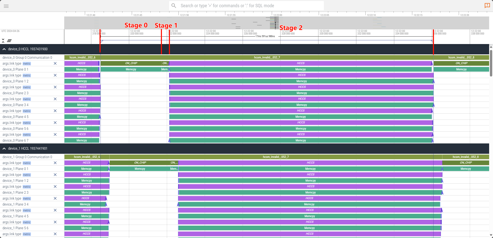

##### Stage 0 - Set a send buffer of the same size as the source buffer and complete a full copy of the original data

| src | dst | type | size |
|-----|-----|------|------|
| 0 | 0 | CHIP | 2GB |

##### Stage 1 - On the local machine, copy 256MB of data

> Note: Why is this step necessary?

| src | dst | type | size |
|-----|-----|------|------|
| 0 | 0 | CHIP | 256MB |

##### Stage 2 - Receive data from other nodes

| src | dst | type | size |
|-----|-----|------|------|
| 0 | others (7) | HCCS | 256MB |
| others(7) | 0 | HCCS | 256MB |

### 4.3.4 broadcast

#### A. Communication Primitive

Broadcast is a 1-to-many communication primitive, with one data sender and multiple data receivers. It broadcasts a node’s own data to other nodes in the cluster. As shown in the figure below, circles represent training accelerator nodes in the cluster, and squares of the same color represent the same data. When node 0 performs a Broadcast, the data is broadcast from node 0 to other nodes.

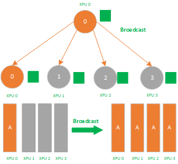

<center>Broadcast Process</center>

Broadcast is a 1-to-many synchronous communication, which synchronizes data from one XPU card to all other XPU cards. Application scenarios include:

- Data parallel parameter initialization, ensuring that the initial parameters are consistent across all cards.
- Broadcast + reduce combination in allReduce.
- In the parameter server structure of distributed training, the master node broadcasts data to worker nodes, and then worker nodes reduce data back to the master node, involving broadcast operations.

#### B. Host Side Memory

| Rank ID | Type | Host Pointer | Host Size | Value |
|---------|------|--------------|-----------|-------|
| 0 | init_buff | 0x124380000000 | 2GB | 1 |
| 0-7 | check_buff | 0x124780000000 | 2GB | 1 |

#### C. Device Side Memory

| Rank ID | Type | Pointer | Malloc | Trans Count |
|---------|------|---------|--------|-------------|
| 0-7 | send | 0x1242c0000000 | 2GB | 512M (2GB) |
| 0-7 | recv | 0x1242c0000000 | 2GB | 512M (2GB) |

#### D. Trace Analysis

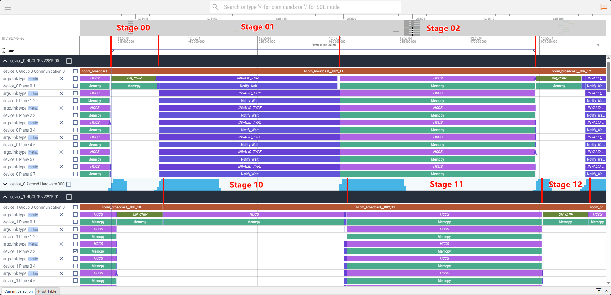

##### Stage 00 - Rank0 copies a full copy of data to the send buffer

| src | dst | type | size |
|-----|-----|------|------|
| 0 | 0 | CHIP | 2GB |

##### Stage 01&10 - Rank0 divides its data into 8 parts and distributes them to other 7 NPU

| src | dst | type | size |
|-----|-----|------|------|
| 0 | 0 | NOTIFY_WAIT | NA |
| others (7) | 0 | HCCS | 256MB |

##### Stage 02&11 - Exchange data, complete Broadcast operation

| src | dst | type | size |
|-----|-----|------|------|
| 0-7 | others (7) | HCCS | 256MB |

##### Stage 12 - Others copy data from buffer to receive area

| src | dst | type | size |
|-----|-----|------|------|
| 1-7 | 1-7 | CHIP | 2GB |
